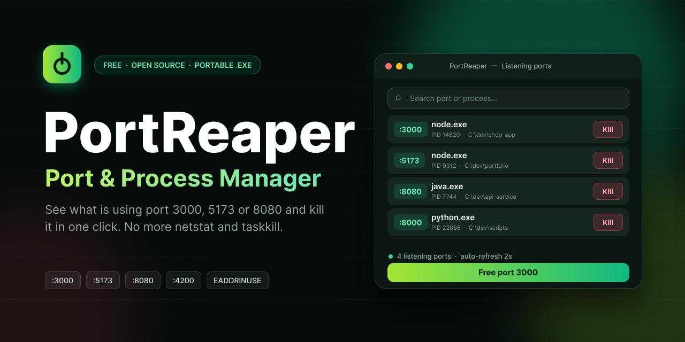

<div align="center">

# PortReaper: Kill Process on Port, Port & Process Manager for Windows

**See what is using port 3000, 5173, 8080 or any other port, and kill it in one click. A free, portable Port and Process Manager for developers. No more `netstat`, `taskkill` and "EADDRINUSE: address already in use".**

[](https://github.com/GateShears93/portreaper-port-process-manager/releases)
[](LICENSE)
[](#installation)
[](https://github.com/GateShears93/portreaper-port-process-manager/stargazers)

[Download](#installation) · [Features](#features) · [How it works](#how-it-works) · [FAQ](#faq) · [Contributing](#contributing)



</div>

---

## Why PortReaper?

You start your dev server and get this:

```
Error: listen EADDRINUSE: address already in use :::3000
```

Something is still holding the port: a zombie Node process, a forgotten Docker container, an old Python server. Finding it with `netstat -ano | findstr :3000` and then `taskkill /PID ... /F` every time is slow and annoying.

**PortReaper** shows every listening port with the process behind it and lets you kill it with one click. It is a portable, single-folder desktop app: no installer, no command line.

## Features

- **Live list of all listening ports** (TCP and UDP) with PID, process name, path and user.
- **Instant search and filter** by port number, process name or path.
- **One-click kill** for a process, or for the whole process tree.
- **Quick-free buttons** for popular dev ports: `3000`, `3001`, `4200`, `5000`, `5173`, `8000`, `8080`, `8888`, `9000`.
- **Open in browser**: jump to `http://localhost:PORT` from the list.
- **Copy PID / port / path** to the clipboard.
- **Auto-refresh** with adjustable interval.
- **Safety first**: confirmation before killing, protected system processes are hidden or locked.
- **Run as administrator** option for processes started with elevated rights.
- **100% offline**, no telemetry, no accounts.
- **Portable** and **open source (MIT)**.

## How it works

1. **Open PortReaper.** The list of listening ports loads instantly.
2. **Find your port**: type `3000` in the search box.
3. **Click Kill.** The process is stopped and the port is free again.

## Common problems it solves

- `EADDRINUSE: address already in use` (Node.js, Express, Next.js, Vite, React, Angular)
- `Port 8080 is already in use` (Spring Boot, Tomcat, Docker, Java)
- `OSError: [Errno 98] Address already in use` (Python, Flask, Django)
- "Something is running on port 5000 / 5173 / 4200 and I don't know what"
- Orphaned dev servers after a crashed terminal or IDE
- Finding which app is silently listening on a port

## Installation

1. Go to the [**Releases**](https://github.com/GateShears93/portreaper-port-process-manager/releases/latest) page.
2. Download `PortReaper.zip`.
3. Extract the archive and run `PortReaper.exe`.

Direct link to the latest version:
`https://github.com/GateShears93/portreaper-port-process-manager/releases/latest/download/PortReaper.zip`

> **Windows SmartScreen / antivirus warning?** The app is not code-signed yet, so Windows may warn about an unknown publisher. Tools that stop processes are sometimes flagged by antivirus heuristics. The full source code is in this repository and you can build the app yourself (see [Building from source](#building-from-source)).

## Safety

- Always asks for confirmation before killing a process.
- Critical system processes are protected.
- Killing a process can cause unsaved data loss in that program: save your work first.
- Some processes need administrator rights, restart PortReaper as administrator for those.

## Building from source

```bash
git clone https://github.com/GateShears93/portreaper-port-process-manager.git
cd portreaper-port-process-manager

# Add your build commands here, for example:
# dotnet publish -c Release -p:PublishSingleFile=true
# pyinstaller --onefile src/main.py
# cargo build --release
```

## FAQ

**How do I find what is using a port on Windows?**
Open PortReaper and search for the port number. The process name, PID and path are shown in the list.

**How do I kill a process on port 3000?**
Search `3000` and click Kill, or use the quick-free button for 3000.

**Is it safe?**
PortReaper asks for confirmation and protects system processes. Only kill processes you recognize.

**Why does a port stay busy after I close my app?**
Usually a child process survived (for example a Node worker). Use *Kill process tree* to stop the whole chain.

**Does it send any data?**
No. PortReaper works fully offline and collects no telemetry.

**Windows only?**
The first release targets Windows. Linux and macOS builds are on the [roadmap](#roadmap).

## Roadmap

- [ ] Linux and macOS builds
- [ ] Command-line mode (`portreaper kill 3000`)
- [ ] System tray mode with notifications
- [ ] Favorite and pinned ports
- [ ] Docker container detection
- [ ] Code signing
- [ ] Multi-language UI

## Contributing

Contributions are welcome! Read [CONTRIBUTING.md](CONTRIBUTING.md), then open an issue or a pull request. If PortReaper saved you time, a star on the repo helps other developers find it.

## License

[MIT](LICENSE) © GateShears93

---

<sub>Keywords: kill process on port, port manager, process manager, find process using port, netstat alternative, taskkill alternative, EADDRINUSE fix, address already in use, free port 3000, free port 8080, localhost port killer, Windows developer tools, portable exe.</sub>
